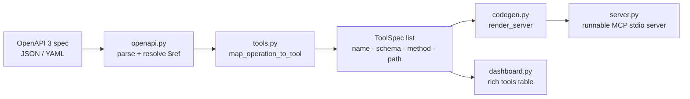

<div align="center">


# mcpforge

**Turn any OpenAPI 3 spec into a runnable MCP server — one command, zero boilerplate.**

_Built and maintained by **Viprasol Tech**._

[](https://github.com/Viprasol-Tech/mcpforge/actions/workflows/ci.yml)
[](LICENSE)
[](https://www.python.org/)
[](https://github.com/Viprasol-Tech/mcpforge)
[](https://t.me/viprasol_help)

</div>

---

`mcpforge` reads an **OpenAPI 3** document and emits a ready-to-run **[Model Context Protocol](https://modelcontextprotocol.io) server**. Every operation (`path` + `method`) becomes one MCP **tool**: the tool name comes from `operationId` (or a clean `get_pets_petId` fallback), and a JSON-Schema `inputSchema` is built by merging path / query / header parameters with the `application/json` request body. Local `$ref`s are resolved for you. The result is a single Python file your LLM agent can call.

It is a **codegen tool, not a runtime proxy**. The forge itself never imports the `mcp` SDK and never makes a network call — the SDK only appears as an `import` in the *generated* file. That keeps the core a pure, fully-tested transformation: **`OpenAPI dict -> list[ToolSpec] -> server.py`**. You can `pip install -e .` and run `mcpforge demo` in 60 seconds with no spec and no SDK.

## What you get

Run `mcpforge demo` and the bundled petstore spec turns into a ranked tools table plus a preview of the generated server. This is the real output:

```text
       mcpforge :: Petstore v1.2.0  (3 tools)
┏━━━┳━━━━━━━━━━━━┳━━━━━━━━┳━━━━━━━━━━━━━━┳━━━━━━━━┳━━━━━━━━━━┓
┃ # ┃ Tool       ┃ Method ┃ Path         ┃ Inputs ┃ Required ┃
┡━━━╇━━━━━━━━━━━━╇━━━━━━━━╇━━━━━━━━━━━━━━╇━━━━━━━━╇━━━━━━━━━━┩
│ 1 │ listPets   │  GET   │ /pets        │      2 │        0 │
│ 2 │ createPet  │  POST  │ /pets        │      3 │        1 │
│ 3 │ getPetById │  GET   │ /pets/{petId}│      1 │        1 │
└───┴────────────┴────────┴──────────────┴────────┴──────────┘

Generated server (first lines):

"""Auto-generated MCP server for Petstore (v1.2.0)."""
from __future__ import annotations
import asyncio, json
from typing import Any
import mcp.types as types
from mcp.server import Server
from mcp.server.stdio import stdio_server

app: Server = Server('petstore')
_TOOLS: list[types.Tool] = [
    types.Tool(
        name='listPets',
        description='List all pets',
        inputSchema={ "type": "object", "properties": { ... } },
    ),
    ...
]
```

The emitted file has a `list_tools` handler returning every tool and a `call_tool` dispatcher that echoes the resolved `(method, path, arguments)` — a safe stub you swap for a real `httpx` call to your backend.

## 60-second Quickstart

```bash
git clone https://github.com/Viprasol-Tech/mcpforge.git
cd mcpforge
pip install -e .

mcpforge demo                          # bundled sample: tools table + generated code
mcpforge inspect openapi.yaml          # see the tools for YOUR spec, write nothing
mcpforge gen openapi.yaml -o server.py # emit a runnable MCP server
```

No spec required for the demo. No `mcp` SDK required to generate. Reading both `.json` and `.yaml/.yml` works out of the box.

## Features

- 🔧 **OpenAPI 3 → MCP tools** — one tool per `(path, method)`, faithfully named and described.
- 🧩 **Real input schemas** — path / query / header parameters merged with the JSON request body into a single `{"type":"object", ...}` JSON Schema, required-flags preserved.
- 🔗 **`$ref` resolution** — local `#/components/schemas/...` references are inlined automatically.
- 🏷️ **Smart naming** — `operationId` when present, a sanitized `get_pets_petId` fallback when not, with collision-safe suffixes and valid Python identifiers.
- 📦 **Runnable output** — emits the official low-level `mcp.server` stdio pattern; every generated file is guaranteed to `compile()`.
- 🧪 **Pure & testable core** — the transformation is just data in, source out; no SDK, no network, deterministic everywhere.
- 🎨 **Rich CLI** — colour-coded tools table and syntax-highlighted code preview.
- 📄 **JSON & YAML** — point it at either; the extension picks the loader.

## Python usage

```python
from mcpforge import parse_openapi, render_server, SAMPLE_OPENAPI

parsed = parse_openapi(SAMPLE_OPENAPI)        # -> ParsedAPI
print(parsed.tool_names())                    # ['listPets', 'createPet', 'getPetById']

tool = parsed.tools[1]                         # createPet
print(tool.method, tool.path)                  # post /pets
print(tool.input_schema["required"])           # ['name']

source = render_server(parsed)                 # the server.py as a string
compile(source, "server.py", "exec")           # always valid Python
```

Lower-level helpers are exported too:

```python
from mcpforge import build_input_schema, map_operation_to_tool, sanitize_identifier

sanitize_identifier("get pet/by-id!")          # 'get_pet_by_id'
schema = build_input_schema(
    parameters=[{"name": "petId", "in": "path", "required": True, "schema": {"type": "integer"}}],
    request_body_schema=None,
)
# {'type': 'object', 'properties': {'petId': {'type': 'integer'}}, 'required': ['petId']}
```

## How it works



Each path item is walked in document order; path-level `parameters` are merged into every operation; the `application/json` request body is flattened into the tool's input schema (with the full payload also exposed as `body`). The whole chain is side-effect-free until you ask the CLI to write a file.

## CLI reference

| Command | What it does |
| --- | --- |
| `mcpforge demo` | Run against the bundled petstore sample and print the tools table + a code preview. |
| `mcpforge inspect SPEC` | Parse a `.json`/`.yaml`/`.yml` spec and print the tools table (writes nothing). |
| `mcpforge gen SPEC -o OUT.py` | Generate a runnable MCP server and write it to `OUT.py` (`--out`/`-o`). |
| `mcpforge version` | Print the installed version. |

## Roadmap

- [x] OpenAPI 3 parser with local `$ref` resolution
- [x] Parameter + JSON request-body → JSON-Schema input
- [x] `operationId` / fallback naming with identifier sanitization
- [x] `compile()`-clean stdio MCP server codegen
- [x] Rich CLI: `demo`, `inspect`, `gen`, `version`
- [ ] First-class `httpx` request bodies (replace the echo stub)
- [ ] Response-schema → tool output typing
- [ ] Security-scheme → MCP auth wiring
- [ ] `--transport sse` and FastMCP output targets

## FAQ

**Do I need the `mcp` SDK installed to use mcpforge?** No. The forge never imports it — the SDK only appears as an `import` inside the file you generate. Install `mcp` when you actually run that server.

**Does the generated server call my API?** Not yet — `call_tool` ships as a safe echo stub that returns the resolved route and arguments. Drop in an `httpx` call to make it live.

**JSON or YAML?** Both. The file extension selects the loader (`.json` → stdlib, `.yaml`/`.yml` → `yaml.safe_load`).

**Are the schemas real?** Yes. Parameters and request bodies become a genuine JSON-Schema `object` with correct `required` lists and types, and `$ref`s are resolved. It's unit-tested end-to-end, including that every generated module compiles.

---

### ⭐ Star mcpforge if it saved you a day of MCP boilerplate

## Contact — Viprasol Tech Private Limited
- Website: [viprasol.com](https://viprasol.com)
- Email: [support@viprasol.com](mailto:support@viprasol.com)
- Telegram: [t.me/viprasol_help](https://t.me/viprasol_help) | WhatsApp: +91 96336 52112
- GitHub: [@Viprasol-Tech](https://github.com/Viprasol-Tech) | [LinkedIn](https://www.linkedin.com/in/viprasol/) | X [@viprasol](https://twitter.com/viprasol)

## License

[MIT](LICENSE) (c) 2025 Viprasol Tech Private Limited
